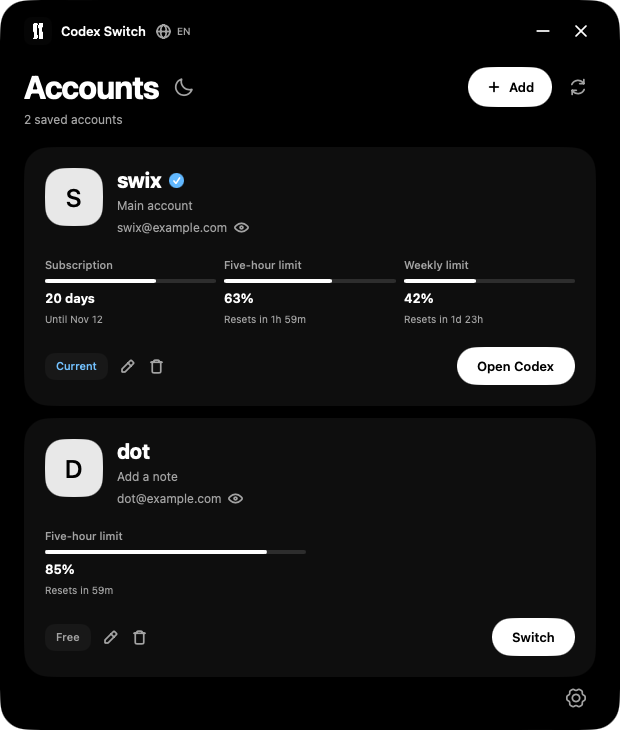

# Codex Switch

Simple account switcher for Codex

   

**[Windows x64](https://github.com/2bekind/codex-switch/releases/latest/download/Codex.Switch.exe)** · **[Windows x86](https://github.com/2bekind/codex-switch/releases/latest/download/Codex.Switch.x86.exe)** · **[macOS](https://github.com/2bekind/codex-switch/releases/latest/download/Codex.Switch.macOS.dmg)** · [All downloads](https://github.com/2bekind/codex-switch/releases/latest)

## Support with USDT

| Network | Address |
| :--- | :--- |
| TRON · TRC20 | `TB8TFbyv5XX5G7V4FBKsHGnHy3Me5JhxZx` |
| TON | `UQBlSkFj9BwdzYuNnP_L-lozJmxAPYsazM7KSvDwB75V6fkK` |
| Ethereum · ERC20 | `0x9ea7b6ddcf8f641ea27c27f3c36887bf432e146d` |
| Solana · SPL | `HtFCGG9BRbwxxFT4bk8GnzPrskpRGVuKYzAA9oivayY3` |

## Preview

<table>
  <tr>
    <td align="center"></td>
    <td align="center"></td>
  </tr>
  <tr>
    <td align="center">Accounts & limits</td>
    <td align="center">Light theme</td>
  </tr>
</table>

Screenshots use demo accounts.

### macOS

## Features

- Switch between saved Codex accounts.
- See remaining limits, reset times and subscription days.
- Get system notifications when limits recover or a paid subscription ends.
- Keep a name and note for each account.
- Hide email addresses with one click.
- Open profile avatars with a smooth zoom and frosted background.
- OLED black and light themes with a circular transition.
- Russian and English interface, initially selected from Windows settings.
- Smooth scrolling and language transitions.
- Profile avatars and SF Pro when installed.
- Interface icons from coolicons.
- Settings for startup, notifications, appearance and account recovery.
- Optional launch at login, including a quiet start in the tray or menu bar.

## Usage

1. On Windows, download **Codex Switch.exe** (x64) or **Codex Switch x86.exe** and run it. On Mac, open the DMG and drag **Codex Switch** into **Applications**.
2. Click **Add** and sign in to the account you want to save.
3. Click **Switch** next to an account, then confirm the Codex restart. Finish running tasks before switching.
4. Click the pencil to edit an account's name or note. Click the eye to hide its email.

Click an avatar to view it. Click outside the image or press **Escape** to close it.

Closing the window sends Codex Switch to the system tray on Windows or the menu bar on Mac. Click its icon to reopen it. Right-click the icon and choose **Exit** or **Quit** to stop the app completely. Limits and notifications keep working in the background.

The current Codex account is saved on first launch. **Ctrl+R** refreshes account data and limits. Open the gear at the bottom right for settings. **Other → Restore previous** restores the previous sign-in; **Data** opens the local data folder. **System** controls startup and notifications, and **Appearance** changes the theme.

**Windows:** Windows 10/11 x64, .NET Framework 4.8 and the Microsoft Store version of Codex, signed in through ChatGPT. Both switcher builds are tested on Windows x64.

**Mac:** macOS 13 or later and Codex installed in Applications. One universal download works on Apple Silicon and Intel. The Mac build is not notarized. If macOS blocks the first launch, use **System Settings → Privacy & Security → Open Anyway**. [Apple's instructions](https://support.apple.com/en-us/102445).

The interface supports Russian and English. Click the globe beside the title to change the language, or the moon and sun beside Accounts to change the theme.

## Notifications

Codex Switch keeps running when you close its window. Notifications continue for:

- Five-hour limit recovery.
- Weekly limit recovery.
- A Plus or Pro subscription changing to Free.

Events are confirmed with fresh server data. The end of a billing period alone does not trigger an expiry notification. Notification history persists across app restarts to prevent duplicates.

Choose which notifications to receive in **Settings → System**, or turn them off entirely.

## Local data

On Windows, saved sign-ins are encrypted with DPAPI and stored in `%LOCALAPPDATA%\CodexSwitch`. On Mac, saved sign-ins use the macOS Keychain; names, notes and cached avatars are stored in `~/Library/Application Support/Codex Switch`. Account profiles and limits are requested using each saved sign-in.

Downloads contain no saved accounts, tokens or personal profile data. Source code is not published here.

## Repository stats

 

The download counter counts release assets. Downloads from the EXE link in the repository are not included.

---

Interface icons: [coolicons by Kryston Schwarze](https://github.com/krystonschwarze/coolicons), licensed under [CC BY 4.0](https://creativecommons.org/licenses/by/4.0/). Adapted to WPF vector drawing, resized and recolored; the subscription badge uses a filled background.

Codex Switch is an independent utility and is not affiliated with OpenAI.

---

### Support Codex Switch

Support development on Boosty.

