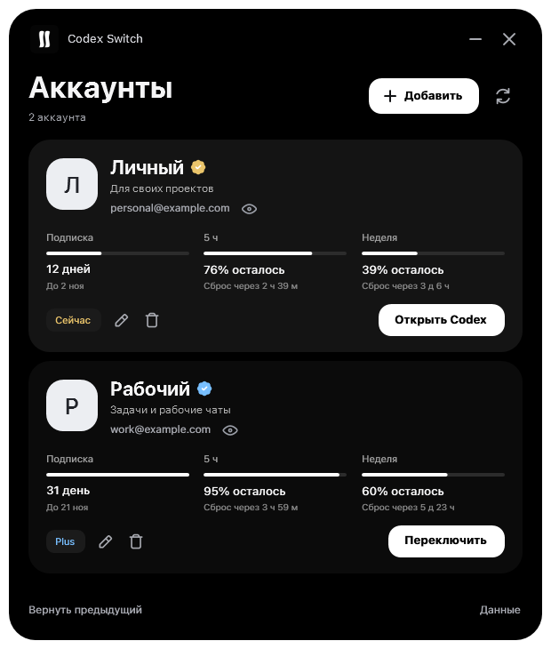
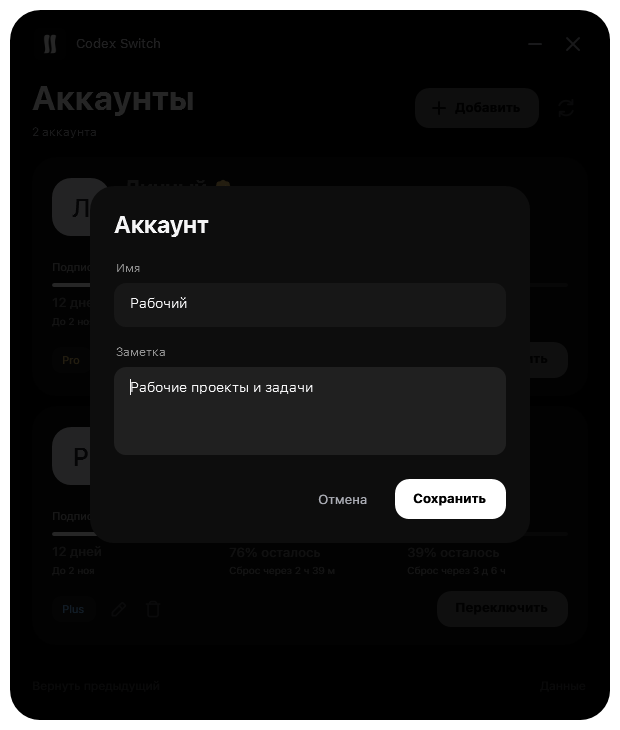

# Codex Switch

Simple account switcher for Codex

  

**[Download EXE](https://github.com/2bekind/codex-switch/raw/refs/heads/main/Codex%20Switch.exe)** · [Releases](https://github.com/2bekind/codex-switch/releases) · [Usage](#usage)

## Preview

<table>
  <tr>
    <td align="center"></td>
    <td align="center"></td>
  </tr>
  <tr>
    <td align="center">Accounts & limits</td>
    <td align="center">Names & notes</td>
  </tr>
</table>

Screenshots use demo accounts.

## Features

- Switch between saved Codex accounts.
- See remaining limits, reset times and subscription days.
- Get Windows notifications when limits recover or a paid subscription ends.
- Keep a name and note for each account.
- Hide email addresses with one click.
- Open profile avatars with a smooth zoom and frosted background.
- OLED black interface, profile avatars and SF Pro when installed.
- Interface icons from coolicons.

## Usage

1. Download **Codex Switch.exe** and run it. No installer is needed.
2. Click **Добавить** (Add) and sign in to the account you want to save.
3. Click **Переключить** (Switch) next to an account, then confirm the Codex restart. Finish running tasks before switching.
4. Click the pencil to edit an account's name or note. Click the eye to hide its email.

Click an avatar to view it. Click outside the image or press **Escape** to close it.

Closing the window sends Codex Switch to the system tray. Click its tray icon or launch the EXE again to reopen it. Right-click the tray icon and choose **Выйти** (Exit) to quit completely. Limits and notifications keep working in the tray.

The current Codex account is saved on first launch. **Ctrl+R** refreshes account data and limits. **Вернуть предыдущий** restores the previous sign-in.

Requires Windows 10/11 x64, .NET Framework 4.8 and the Microsoft Store version of Codex signed in through ChatGPT. The interface is currently in Russian. SF Pro falls back to Segoe UI when unavailable.

## Notifications

Codex Switch keeps running in the system tray when you close its window. Windows notifications continue for:

- Five-hour limit recovery.
- Weekly limit recovery.
- A Plus or Pro subscription changing to Free.

Events are confirmed with fresh server data. The end of a billing period alone does not trigger an expiry notification. Notification history persists across app restarts to prevent duplicates.

## Local data

Saved sign-ins are encrypted with Windows DPAPI for the current Windows user and stored in `%LOCALAPPDATA%\CodexSwitch`. Account profiles and limits are requested using each saved sign-in. Account names and notes stay in the local account list.

This repository contains the Windows executable and demo images. It includes no saved accounts, tokens or personal profile data. Source code is not published here.

## Repository stats

 

The download counter counts release assets. Downloads from the EXE link in the repository are not included.

---

Interface icons: [coolicons by Kryston Schwarze](https://github.com/krystonschwarze/coolicons), licensed under [CC BY 4.0](https://creativecommons.org/licenses/by/4.0/). Adapted to WPF vector drawing, resized and recolored; the subscription badge uses a filled background.

Codex Switch is an independent utility and is not affiliated with OpenAI.
